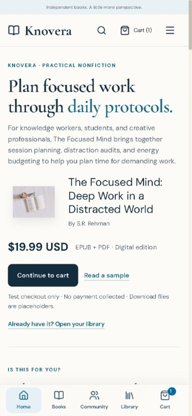

# Knovera sales landing page — implementation and verification

Date: 12 October 2026
Preview: http://localhost:3001/

## Customer journey

Relevant focus-work promise → recognizable planning needs → tools and chapter scope → approved excerpt → digital offer → access and format answers → other books for different audiences.

The featured title is the first existing featured ebook, currently The Focused Mind. It is not described as a bestseller. Habit-building readers and parents receive separate routes below its offer. Newsletter signup remains in the footer after the primary buying argument.

## Features and source paths

| Feature | Decision supported | Source |
| --- | --- | --- |
| Server reads current published catalog; meaningful empty fallback | Show current editions rather than stale promotional data | [Homepage](../../app/page.tsx) |
| Benefit-led hero, actual uncropped catalog image, audience, price, format | Recognize relevance and the next step on the first screen | [SalesLanding](../../components/home/SalesLanding.tsx) |
| Three concrete tool-to-use explanations | Understand how session planning, distraction audits and energy budgeting could be used | SalesLanding |
| Approved excerpt plus four real contents entries | Assess writing and scope before deciding | SalesLanding |
| Included edition contents and price | Know what the catalog lists as included | SalesLanding |
| Visible compatibility, access and test-fulfillment answers; compact FAQ | Resolve remaining doubts without hiding essential information | SalesLanding |
| Purchase action repeated after evidence and in offer | Act after a new reason to consider the book | [PurchaseAction](../../components/home/PurchaseAction.tsx) |
| Existing cart modal and checkout destination; continue-to-cart when already added | Avoid accidental duplicate additions from repeated controls | PurchaseAction |
| Library access link for returning readers | Reach existing books without starting a new purchase | PurchaseAction / SalesLanding |
| Audience-specific related titles after offer | Separate habits and children's activities from focus-work argument | SalesLanding |
| Mobile layout, editorial excerpt, restrained borders and brand colors | Keep content readable and purchase/sample controls visible | [Styles](../../app/storefront.css) |

Product title, author, formats, price, availability, excerpt, contents and included tools derive from existing catalog data. No discounts, reviews, ratings, guarantees, urgency or customer counts were added. Seeded demo reviews are excluded. The existing image is retained; it is a placeholder photo rather than finished cover artwork. No full paid manuscript is loaded. Only approved sampleExcerpt text is shown.

## Verification

- Production `npm run build`: passed, 43 routes generated.
- TypeScript `npx tsc --noEmit`: passed.
- Changed-file ESLint: passed (homepage and both new components).
- Existing community/storefront Node suite: 10 passed.
- `git diff --check`: passed, expected Windows line-ending notices only.
- Browser: Get the ebook added the actual featured edition through existing cart provider and opened native dialog; Escape closed it.
- Repeated actions changed to Continue to cart for an existing cart entry, rather than adding another copy.
- Sample action opened /samples/the-focused-mind; keyboard ArrowRight moved from section 1 to section 2.
- Cart → checkout retained $19.99 USD and the EPUB + PDF edition. No new order submitted in this refresh.
- Widths 320, 390, 768, 1024, 1280: no horizontal overflow. Mobile primary controls visible on opening screen.
- Server Suspense loading fallback retained. Storage errors reuse existing cart feedback. Backend checkout, order status, download implementation and API contracts are unchanged; the existing test suite checks payment gating, excerpt pagination and shopping persistence.
- Prior end-to-end simulator/download validation is recorded in [previous verification](../storefront/VERIFICATION.md); it was not repeated as a new purchase in this refresh.

## Missing information and integrations

Live payments, genuine EPUB/PDF assets, verified library identity and outgoing receipt emails remain incomplete. Current checkout collects no payment and issues placeholder files; every purchase block discloses this.

The existing policy route contains live-delivery and emailed-receipt wording that differs from the current simulator. This refresh links the existing policy and explicitly explains that mismatch; it does not create or rewrite commercial/legal promises.

Final cover artwork, interior illustrations and authenticated review evidence were not available. The existing approved text excerpt supplies product evidence. No author identity was added beyond the already published catalog author.

No analytics provider was found in app/components/lib. No new tracking dependency or personal data collection was introduced. A future measurement plan should distinguish sample opens, book selection, cart additions and checkout starts from provider-confirmed purchases. The redesign's conversion benefit is a hypothesis, not a measured result.

A mobile sticky purchase bar was not added: the opening actions are visible and the existing bottom navigation already provides cart access. Repeated inline controls avoid stacking fixed overlays.

## Screenshots

